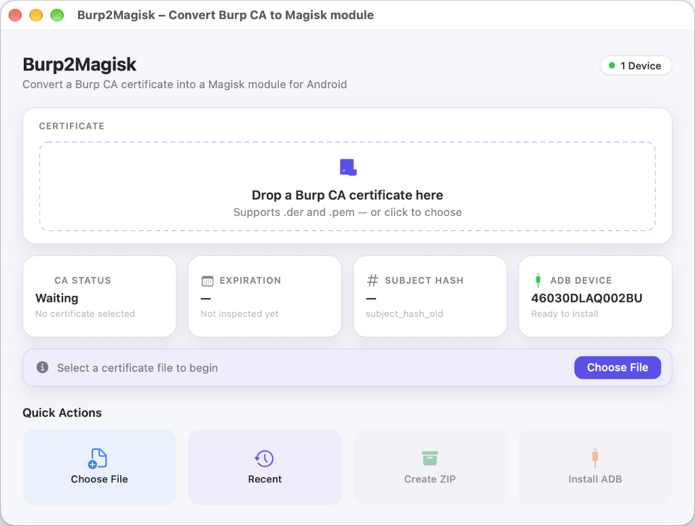

# Burp2Magisk for macOS

A native Swift/AppKit macOS app that converts a Burp Suite CA certificate (`.der` or `.pem`) into a Magisk module ZIP for Android — with live certificate inspection and optional one-click ADB installation.



## Download v1.1.0

Download [Burp2Magisk-macOS.zip](https://github.com/NonBytes/Burp2Magisk/releases/download/v1.1.0/Burp2Magisk-macOS.zip) from [GitHub Releases](https://github.com/NonBytes/Burp2Magisk/releases/latest) for **macOS 12+ on Apple Silicon (arm64)**. No Python or Homebrew required.

To verify the download checksum, place `Burp2Magisk-macOS.zip` and `SHA256SUMS.txt` in the same folder and run:

```bash
shasum -a 256 -c SHA256SUMS.txt
```

## Features

- **Single-certificate workflow**: Drag and drop a `.der` or `.pem` CA certificate, pick one via **Choose File**, or reopen from **Recent**.
- **Live certificate inspection**: Validates X.509 `Basic Constraints: CA:TRUE`, rejects malformed files, PEM bundles, and private keys, and displays live **CA Status**, **Expiration**, **Subject Hash** (`<subject_hash_old>.0`), file format/size, and subject details before packaging.
- **Magisk module export**: Builds a ready-to-flash `BurpCA-Magisk.zip` supporting both legacy `/system/etc/security/cacerts` and Android 14+ Conscrypt APEX (`/apex/com.android.conscrypt/cacerts`).
- **Opt-in one-click ADB install**: Automatically detects authorized `adb` devices (read-only `adb devices`; never modifies the device automatically). Click **Install via ADB** right after selecting a valid certificate to build, push, and run `magisk --install-module`. Rebooting always requires an explicit separate confirmation.
- **Self-contained & native**: Zero external dependencies; uses macOS built-in `openssl`, `zip`, and `unzip`. Supports both Light and Dark appearances.

## Usage

1. Unzip `Burp2Magisk-macOS.zip`, drag `Burp2Magisk.app` into `/Applications`, and launch it.
2. Drop your Burp CA certificate (`.der` or `.pem`) into the **CERTIFICATE** card, or click **Choose File**.
3. Choose either:
   - **Create ZIP** to save `BurpCA-Magisk.zip` and flash it manually in Magisk, or
   - **Install via ADB** (when an authorized rooted Android device is connected via USB debugging) to install directly.
4. Reboot your Android device to apply the module.

> [!NOTE]
> Burp2Magisk does not modify the macOS trust store and does not bypass certificate pinning. Android compatibility depends on your device, ROM, and Magisk setup.

## First Launch (Ad Hoc Signed)

Release builds are ad hoc signed and **not Apple notarized**. If macOS blocks the first launch, open **System Settings → Privacy & Security → Open Anyway** (macOS 12: **System Preferences → Security & Privacy → General**) and confirm opening this app, following [Apple's instructions](https://support.apple.com/en-us/102445). You can also build directly from source.

## Build from Source

Requires Xcode Command Line Tools (or Xcode).

- **CLI build**:

```bash
./scripts/test.sh
./build.sh
```

The signed app bundle and release archive are written to `dist/Burp2Magisk.app` and `dist/Burp2Magisk-macOS.zip`.

- **Xcode**: Open `Burp2Magisk.xcodeproj`, select the **Burp2Magisk** scheme on **My Mac**, and press **⌘R**.

Format Swift sources according to `.swift-format` with:

```bash
xcrun swift-format format --in-place --recursive Sources scripts Tests
```

See [CONTRIBUTING.md](CONTRIBUTING.md) for contributor guidelines and icon generation.

## Project Structure

```text
Burp2Magisk.xcodeproj/   Xcode project
Sources/main.swift       AppKit entry point
Sources/App/             Application lifecycle (AppDelegate)
Sources/UI/              Main window, theme, and reusable AppKit components
Sources/Services/        ModuleBuilder and ADBInstaller (decoupled from UI)
Resources/Info.plist     App metadata
Resources/*.sh           Certificate inspection, conversion, and Magisk packaging scripts
Resources/ModuleTemplate/ Magisk post-fs-data and Conscrypt overlay scripts
build.sh                 Builds arm64 app bundle and release ZIP
Tests/                   Integration tests for certificate inspection, ZIP build, and ADB parsing
scripts/test.sh          Runs integration tests headless
```

## Magisk Module Template

The module template lives in `Resources/ModuleTemplate/` and follows the [Magisk Developer Guide](https://topjohnwu.github.io/Magisk/guides.html) (`module.prop` + `customize.sh`, for installation via the Magisk app or `magisk --install-module`; recovery flashing is not supported).

- **Legacy system store**: Handled by Magisk's standard system overlay.
- **Conscrypt APEX store (Android 14+)**: Snapshots existing system CAs and mounts a volatile `tmpfs` overlay inside `init`'s mount namespace during `post-fs-data`, rolling back on failure without modifying underlying APEX files. Boot logs are written to `/data/adb/modules/burp_ca_<hash>/boot.log`.

The current scripts were written from scratch for Burp2Magisk with no external template ZIP downloads; `Resources/ModuleTemplate/LICENSE` retains the original GPL-3.0 notice from earlier project history.
